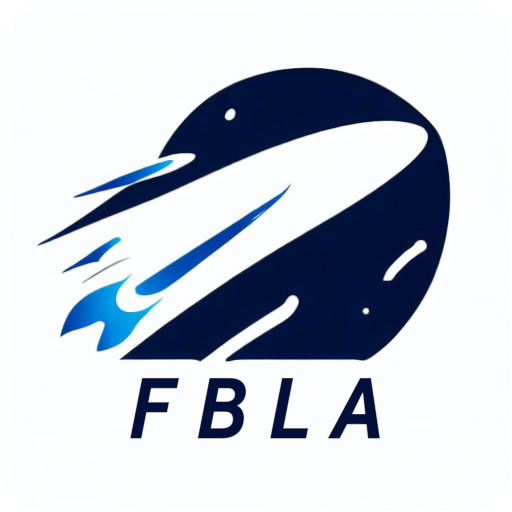

  **Current Status of Website**
   
   
  <ins>ARCHIVED</ins>

   
   
  
  

# [FBLA Website](https://www.marionvillefbla.com/)

This FBLA website empowers us to communicate with our members and our community about our projects and goals. This website was made possible by the Hugo theme [Academic](https://github.com/wowchemy/starter-hugo-academic).

<b>Menu's and Topics on Website:</b>
1. [About](https://www.marionvillefbla.com//#about)
2. [Officers](https://www.marionvillefbla.com//#officers)
3. [Upcoming](https://www.marionvillefbla.com//#upcoming)
4. [Posts](https://www.marionvillefbla.com//#posts)
5. [Events](https://www.marionvillefbla.com//#events)
6. [Gallery](https://www.marionvillefbla.com//#gallery)
7. [Contact](https://www.marionvillefbla.com//#contact)

 

## Wowchemy Acknowledgements:

### [❤️ Click here to become a GitHub Sponsor for Wowchemy Academic!](https://github.com/sponsors/gcushen)

### - [Link for Wowchemy Academic Module](https://github.com/wowchemy/starter-hugo-academic)
